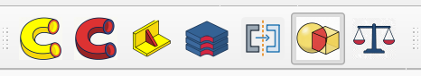
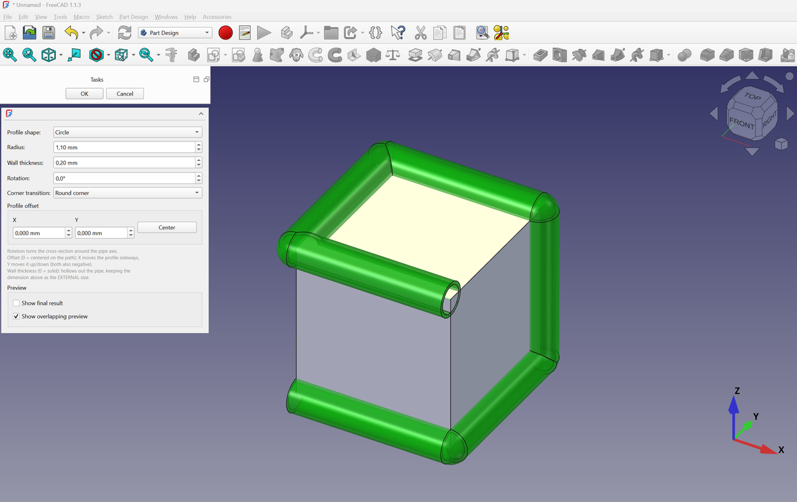
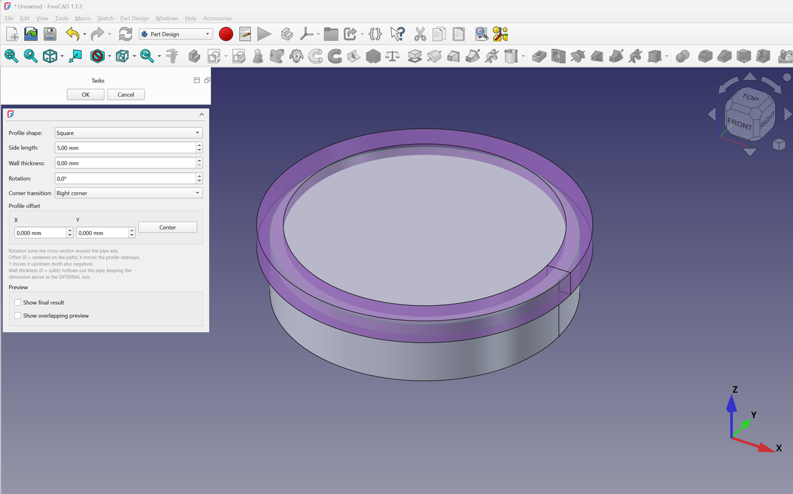
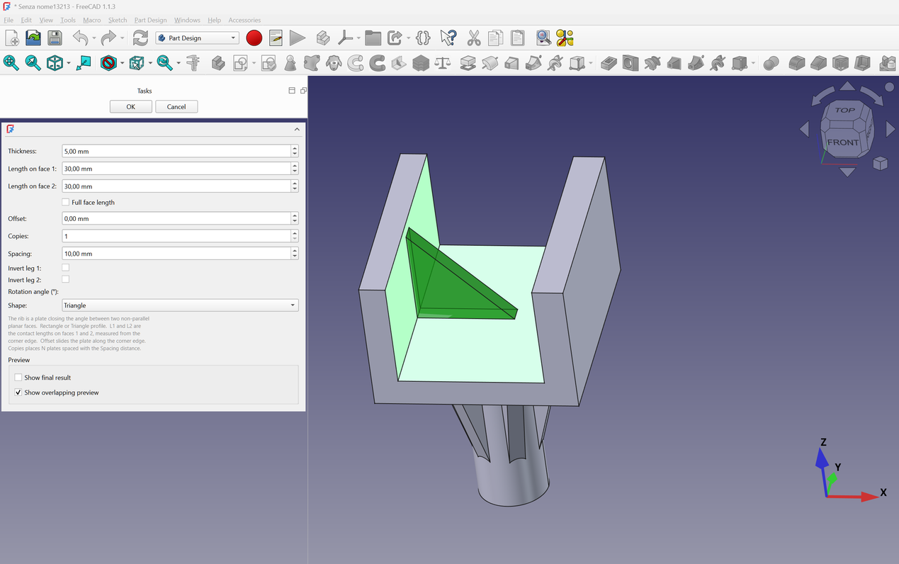
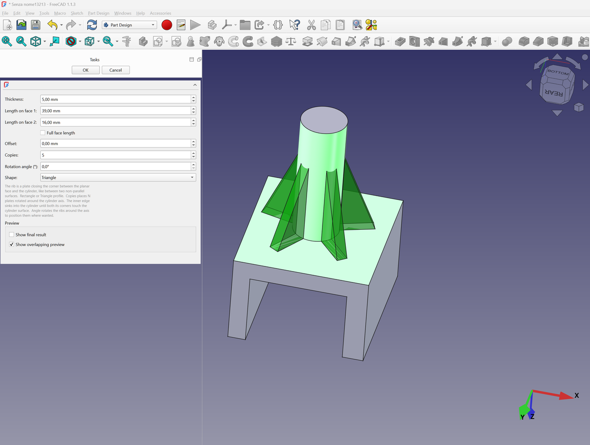
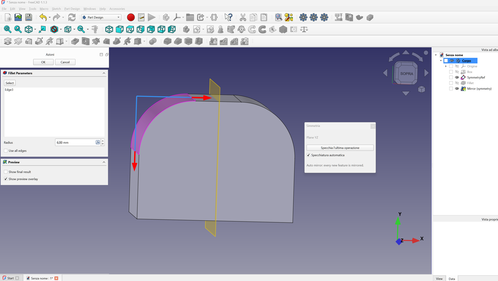
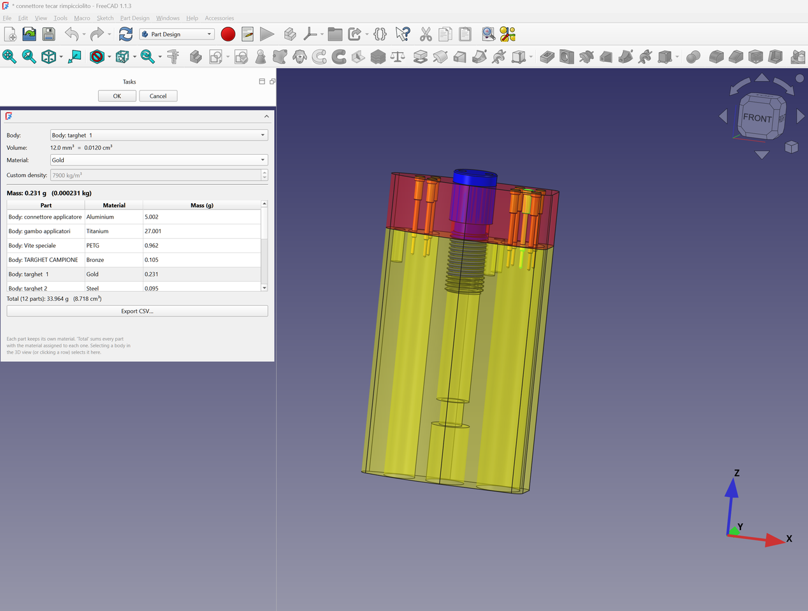
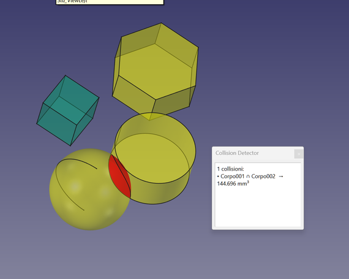

# PartDesignUpgrade

Extends the **PartDesign** workbench with six helpers (the seventh button,
*Collision detector*, comes from the companion **CollisionDetector** addon):

- **Create Pipe** — sweep a parametric profile (circle, square, triangle,
  pentagon, hexagon, octagon) along a sketch or a set of edges. Supports
  rotation, offset, wall thickness (hollow pipe) and corner transitions,
  with a live preview. If the path belongs to a PartDesign body the pipe is
  added as an *additive* feature; otherwise a standalone parametric pipe is
  created.
- **Subtractive Pipe** — the same sweep but the profile is **removed** from
  the body (like a pocket following a path): a *subtractive* feature.
- **Create Rib Between Faces** — build a stiffening rib *without a sketch*:
  select **two faces** and a plate is created **between them**. Two **angled
  planar faces** (a corner) give a triangular gusset whose two long edges rest
  on the two faces (lengths measured from the corner edge; *Invert leg 1/2*
  flips each edge to the other side of the corner); a **planar face plus a
  cylinder** gives one or more radial plates running from the plane up to the
  cylinder (*Copies* rotates them around the cylinder axis, *Rotation angle*
  positions them). Triangle is the default profile, Rectangle also available.
  Added to the active body as an *additive* feature, or standalone when no
  body is active. A *Full face length* checkbox auto-sets the lengths and a
  static helper *sketch* of the rib profile is added to the document tree.
- **Assembly Cut** — cut several PartDesign bodies at once with a single
  sketch. For each body a linked *binder* (or an independent sketch copy) is
  created and a pocket applied automatically, one body after another.
- **Automatic symmetry (Mirror)** — automatic symmetry helper. The command
  opens a small **floating panel** that stays on top of the window
  while you model. Tick **Enable symmetry** and pick the reference:
  **planes** XY / XZ / YZ or **axes** X / Y / Z (a 180° rotation, i.e. 2
  occurrences). The references are measured from the **centre of the body**;
  a plane moves along its normal, an axis along the two independent
  perpendicular directions — *Distance from the body centre* offsets them.
  While enabled, **every new pad /
  pocket is mirrored automatically**, computed by a parametric
  `Part::FeaturePython` object that re-reflects the body after each recompute,
  so the mirror always stays up to date. Untick **Enable symmetry** to stop;
  the **Automatic symmetry** toolbar button is a quick on/off toggle.
- **Weight / Volume** — shows the volume (mm³ / cm³) and the mass of a body
  using a density picker (metals, plastics, wood, glass, concrete, ... or a
  custom value in kg/m³).
- **Collision Detector** — makes every body transparent and highlights the
  overlapping parts in red, re-running automatically after every change.
  Provided by the companion **CollisionDetector** addon.

Together with the **CollisionDetector** addon, the buttons form a single
movable **AddOn Tools** toolbar that can be dragged anywhere on the top bars:

## Installation

The addon is **not a workbench**: it adds no entry to the workbench switcher.
Its buttons are added to the **Part Design Helper Features** toolbar and to the
**Part Design** menu of the Part Design workbench, so they are always at hand
while modelling and you never have to switch workbench.

Use the FreeCAD Addon Manager (Tools → Addon manager) and search for
*PartDesignUpgrade*, or clone this repository into your user Mod directory:

| FreeCAD | Location |
| --- | --- |
| 1.1+ on Windows | `%APPDATA%\FreeCAD\v1-1\Mod\PartDesignUpgrade` |
| 1.1+ on Linux | `~/.local/share/FreeCAD/Mod/PartDesignUpgrade` |
| 1.1+ on macOS | `~/Library/Application Support/FreeCAD/Mod/PartDesignUpgrade` |

## Usage

### Create Pipe / Subtractive Pipe
1. Select a sketch (or edges of a body) as the path.
2. Click **Create Pipe** (adds) or **Subtractive Pipe** (removes) in the
   Part Design Helper Features toolbar.
3. Set profile shape/size, rotation, offset and wall thickness — a live
   preview follows the values.
4. Click OK.

### Assembly Cut
1. Select a sketch that crosses the bodies to cut.
2. Click **Assembly Cut**.
3. Tick the target bodies (in cut order), choose *binder* (linked) or
   *independent copies*, click **Cut Bodies** and accept each pocket.

### Create Rib Between Faces
1. Select **two faces** — two angled planar walls (corner), or a planar face
   plus a cylinder.
2. Click **Create Rib Between Faces**.
3. Corner: set *Length 1* / *Length 2* (contact lengths from the corner edge),
   *Thickness*, *Offset* (slide along the corner edge), *Invert leg 1* /
   *Invert leg 2* (flip a leg to the other side of the corner) and *Copies*
   with *Spacing* for a pattern — a triangular gusset closes the angle
   (Triangle is the default profile).
4. Plane + cylinder: set *Length 1* (height up the cylinder), *Length 2*
   (radial contact on the plane), *Thickness*, *Copies* (radial pattern) and
   *Rotation angle* (Triangle is also the default profile here).
5. Tick **Full face length** to make the lengths automatically cover the whole
   faces (un-tick to edit them manually again).
6. Click OK. A helper *sketch* showing the rib profile is created in the
   document tree next to the rib feature — it is a static snapshot, not
   parametric.

### Automatic symmetry (Mirror)
1. Create a solid in a PartDesign body (e.g. a pad).
2. Click **Automatic symmetry** in the Part Design Helper Features toolbar.
   The first time, a dialog opens to pick the reference; once a symmetry
   exists, the button opens a small **floating panel** that stays on top and
   can be moved anywhere.
3. Choose the reference: **Plane XY / XZ / YZ** (mirror) or **Axis X / Y / Z**
   (a 180° rotation, i.e. 2 occurrences). A plane has one
   *Distance from the body centre (mm)* movement, an axis two (perpendicular
   to it).
4. Tick **Auto mirror** in the panel and **every change to the body is
   mirrored automatically** — a parametric `Symmetry` object reflects the
   body on every recompute, so a pad/pocket you add or edit appears mirrored
   right away. You can also press **Mirror last operation** to mirror only
   the latest feature. Untick **Auto mirror** (or close the panel) to stop.

### Collision detector
1. With a document open, click **Collision Detector** in the **AddOn Tools**
   toolbar.
2. All bodies become transparent and the overlapping parts are highlighted in
   red.
3. The check runs again automatically after every change to the document; click
   the button again to turn it off.

### Weight / Volume
1. Select a body (or any shape with volume).
2. Click **Weight / Volume** and pick the material density.

## Screenshots

### AddOn Tools toolbar

### Create Pipe (additive)

### Subtractive Pipe

### Create Rib Between Faces — angled faces

### Create Rib Between Faces — plane + cylinder

### Automatic symmetry (Mirror)

### Weight / Volume

### Collision detector

The **Collision detector** button (from the companion **CollisionDetector**
addon) makes all bodies transparent and highlights the overlapping parts in
red, then re-runs automatically after every change.

## Compatibility

FreeCAD >= 1.1.0 (PySide6).

## License

LGPL-2.1-or-later — see [LICENSE](LICENSE).